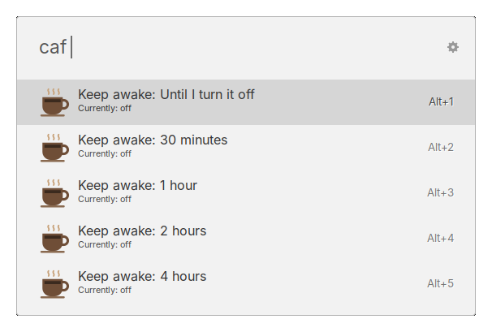

# Caffeinate for Ulauncher

Keep your screen on and stop your computer from sleeping — straight from [Ulauncher](https://ulauncher.io).
Like macOS `caffeinate` or the Amphetamine app.



## Usage

Type `caf` in Ulauncher:

| Item | What it does |
|---|---|
| Keep awake: Until I turn it off | Stays on until you choose **Turn off** |
| Keep awake: 30 minutes / 1 / 2 / 4 hours | Turns itself off after that time |
| `caf 45` · `caf 1h30m` · `caf 2h` | Any custom duration |
| Turn off caffeinate | Lets the screen blank and the computer sleep again |

Each item shows the current state (e.g. *on — 44m left*), and a notification confirms changes.

## How it works

While it's on, a tiny background process holds an inhibit lock:

- **GNOME, Cinnamon, MATE, Budgie…** — `org.gnome.SessionManager.Inhibit` (blocks screen blanking, screensaver lock and suspend)
- **Anything else with systemd** — falls back to `systemd-inhibit --what=idle:sleep`

Turning it off (or the timer running out) ends the process, which releases the lock. Nothing is changed in your power settings.

## Command line

The bundled script also works on its own:

```
./caffeinate.py            # on until turned off
./caffeinate.py 90         # 90 minutes   (also 45m, 2h, 1h30m)
./caffeinate.py status
./caffeinate.py off
```

Tip: symlink it into your PATH — `ln -s "$PWD/caffeinate.py" ~/.local/bin/caffeinate`.

## Requirements

Ulauncher 5 (extension API v2), Python 3 with PyGObject (already present wherever Ulauncher runs).
`notify-send` is optional, for notifications.

## License

MIT
